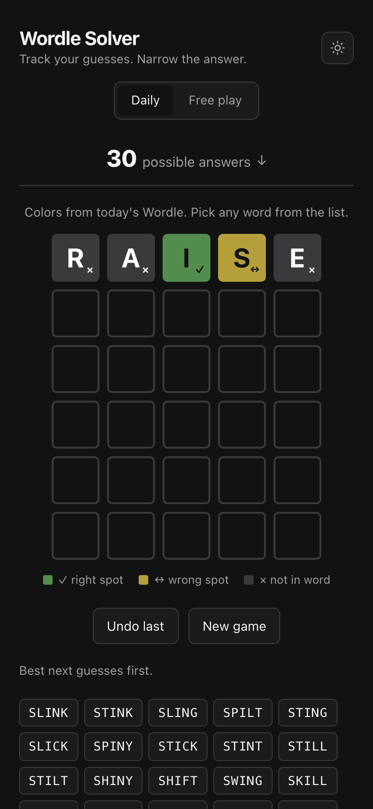
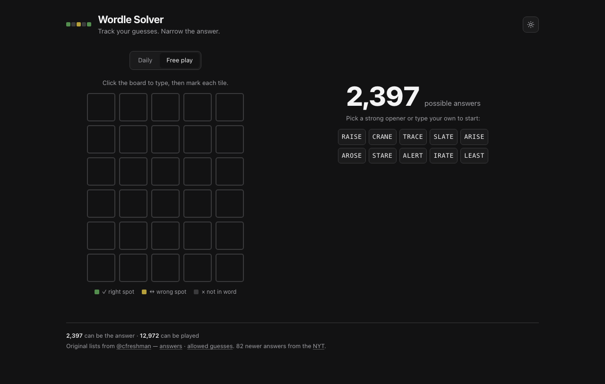

# Wordle Solver

Narrow down today's Wordle answer from the colors of your guesses. Type a guess, mark its five
tiles the way Wordle did, and the candidates narrow as you go.

**[wordle.watermancorley.com](https://wordle.watermancorley.com/)**

<p align="center">
  
  <br><br>
  
</p>

## How it works

- Type a five-letter guess, or tap the board on a phone to raise the keyboard. `Enter` moves to the
  next row.
- In Free play, click each tile to cycle its color: green ✓ right spot, yellow ↔ wrong spot, grey ×
  not in the word. In Daily mode the colors fill in automatically.
- The count and word list narrow as soon as a tile is marked. Unmarked tiles are ignored, so a
  half-filled row never hides the answer.
- Click a suggested opener or any candidate word to load it into the active row.
- `Undo last` clears the most recent guess. `New game` resets the board.
- The theme button switches light/dark and remembers your choice.
- On phones, a sticky bar keeps the live count in view.

## Play modes

- **Daily** (default) fetches today's Wordle answer through the bundled nginx proxy and fills the
  colors in automatically. The answer is used only to color tiles; it is not shown up front.
- **Free play** works on any static host: type a guess and mark the tiles yourself.

Switching modes starts a new board. Daily mode requires the Docker deployment. A browser cannot
call the NYT endpoint directly because it does not send CORS headers; nginx proxies it and stores
each fetched day in `data/wordle/YYYY-MM-DD.json`, so repeats, restarts, and NYT outages use the
stored copy. The endpoint is undocumented, so Daily mode degrades to an error with a Retry button if
it changes or is unavailable and the day was never fetched.

<p align="center">
  
  <br>
  <sub>Free play keeps the same instruction slot above the board.</sub>
</p>
Free play has no network dependency beyond loading the app.

It is a static React + TypeScript bundle. Free play needs no backend; Daily mode uses the same-origin
nginx proxy, which writes the fetched response to disk. The word lists ship with the bundle and
filtering happens in the browser, so the count updates instantly.

## Word lists

- `data/answers.txt` — 2,397 answers: the original 2,315 from @cfreshman's list plus 82
  words the NYT has used since 2022.
- `data/guesses.txt` — 10,575 additional words Wordle accepts as a guess.
- `data/solutions.txt` — every daily solution seen, one word per line. It is committed and merged
  into the answer set at build time.

The original lists come from [@cfreshman's Wordle gists](https://gist.github.com/cfreshman/a03ef2cba789d8cf00c08f767e0fad7b):
the [answer list](https://gist.github.com/cfreshman/a03ef2cba789d8cf00c08f767e0fad7b) and the
[guess-only list](https://gist.github.com/cfreshman/cdcdf777450c5b5301e439061d29694c). The 82
newer answers were verified against the NYT daily solution endpoint and removed from the
guess-only file, so the two lists do not overlap. Last refreshed 2026-11-25.

`data/wordle/` is a local HTTP cache written by nginx, one `YYYY-MM-DD.json` per fetched day. It is
bind-mounted in Docker and ignored by git. `npm run solutions` merges any new solutions from that
cache into `solutions.txt`; it only adds words, never removes them.

Possible answers are filtered from the answer list: `answers.txt` plus `data/solutions.txt`. If a
board matches none of them, the app falls back to the guess-only words, labels them as outside the
answer list, and keeps them separate from the main results.

## Local development

```bash
cd web
npm install
npm run dev      # http://localhost:5173
npm test         # solver and UI tests
npm run build    # typecheck plus static bundle in web/dist
```

`npm run dev` proxies Daily mode straight to NYT; the on-disk cache only runs under Docker.

With Docker:

```bash
make build
make up          # http://localhost:8501
```

The container writes fetched days to `data/wordle/` (bind-mounted). On Linux, make that directory
writable by the container's UID 101: `chown -R 101:101 data/wordle`.

## Tests

`web/src/solver.test.ts` covers the marking rules (including repeated letters) and filtering.
`web/src/App.test.tsx` covers typing, manual marking, Daily auto-marking, fallback results, and the
solved state.
